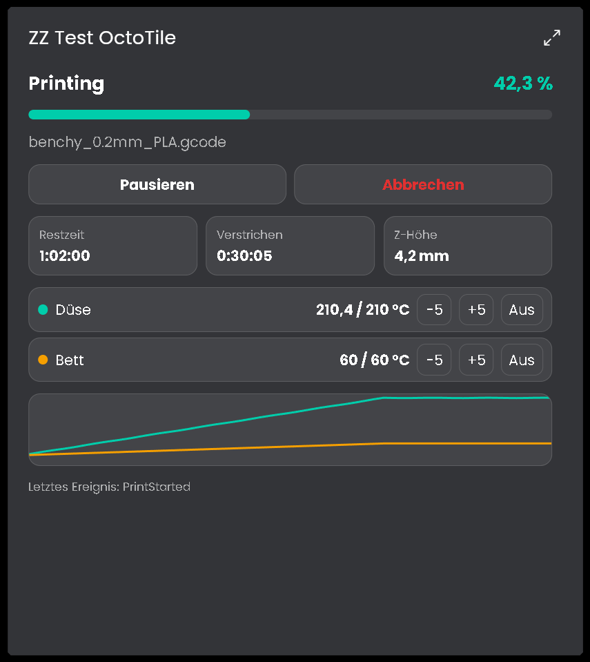

# OctoPrint
Anbindung von OctoPrint an IP-Symcon. Die Bibliothek zeigt den Status des 3D-Druckers, den laufenden Druckjob und die Temperaturen und steuert Druck, Temperaturen, Verbindung und System.

## Inhaltsverzeichnis
- [OctoPrint](#octoprint)
  - [Inhaltsverzeichnis](#inhaltsverzeichnis)
  - [Screenshots](#screenshots)
  - [1. Voraussetzungen](#1-voraussetzungen)
  - [2. Funktionsumfang](#2-funktionsumfang)
  - [3. Enthaltene Module](#3-enthaltene-module)
  - [4. Installation](#4-installation)
  - [5. Konfiguration in IP-Symcon](#5-konfiguration-in-ip-symcon)
  - [6. Spenden](#6-spenden)
  - [7. Lizenz](#7-lizenz)

## Screenshots

## 1. Voraussetzungen

* mindestens IP-Symcon Version 9.0. Die Kachel braucht für die maximierte Ansicht IP-Symcon 9.1.
* OctoPrint 1.8 oder neuer. Für den Button "API Key anfordern" muss das Plugin Application Keys aktiv sein.
* Ein API Key für OctoPrint (Application Key, User-Key oder globaler Key)

## 2. Funktionsumfang

* Anzeige des Druckerstatus und des laufenden Druckjobs
* Anzeige der Temperaturen von zwei Extrudern, Bett und Kammer
* Setzen der Solltemperaturen
* Letztes Ereignis von OctoPrint (zum Beispiel Druck fertig oder fehlgeschlagen)
* Cockpit-Kachel für die Kachel-Visualisierung mit Bedienung von Druck und Solltemperaturen
* Anzeige von Verbindungsproblemen im Instanzstatus
* Druck starten, pausieren, fortsetzen und abbrechen
* Drucker mit OctoPrint verbinden und trennen
* Herunterfahren und Neustart von System und OctoPrint
* Anmeldung am WebSocket von OctoPrint nur mit dem API Key, API Key lässt sich aus IP-Symcon anfordern

Die einzelnen Funktionen stehen bei den Instanzen unter "Enthaltene Module" und in der README des jeweiligen Moduls.

## 3. Enthaltene Module

* [OctoDiscovery](OctoDiscovery/README.md)
  * Sucht OctoPrint-Server im Netzwerk und legt die Verbindungs-Instanzen an.
* [OctoConfigurator](OctoConfigurator/README.md)
  * Legt alle Instanzen zu einem OctoPrint-Server an.
* [OctoConnect](OctoConnect/README.md)
  * Splitter, der Befehle an OctoPrint sendet und die Statusdaten vom WebSocket verteilt.
* [OctoConnectionHandling](OctoConnectionHandling/README.md)
  * Verbindet und trennt den Drucker, Auswahl von Port und Baudrate.
* [OctoCurrentState](OctoCurrentState/README.md)
  * Zeigt den Druckerstatus, startet, pausiert und bricht Drucke ab.
* [OctoPrintjob](OctoPrintjob/README.md)
  * Zeigt Datei, Fortschritt und Zeiten des aktuellen Druckjobs.
* [OctoSystem](OctoSystem/README.md)
  * Fährt das System herunter oder startet System und OctoPrint neu.
* [OctoTemperatures](OctoTemperatures/README.md)
  * Zeigt die Temperaturen und setzt die Solltemperaturen von Extruder, Bett und Kammer.
* [OctoTile](OctoTile/README.md)
  * Cockpit-Kachel: zeigt den Drucker mit Temperaturverlauf und bedient Druck und Solltemperaturen.

## 4. Installation
Die Installation erfolgt über den IP-Symcon Module Store.

## 5. Konfiguration in IP-Symcon
Am einfachsten wird zuerst die OctoDiscovery angelegt und der API Key eingetragen. Über die Liste entstehen der OctoConfigurator, OctoConnect und der WebSocket Client, danach werden im OctoConfigurator die gewünschten Instanzen erstellt.

Von Hand werden die Instanzen in dieser Reihenfolge angelegt:
1. WebSocket Client mit der Adresse `ws://<IP>:<Port>/sockjs/websocket`, aktiv.
2. OctoConnect mit dem WebSocket Client als übergeordneter Instanz. API URL und API Key eintragen.
3. Die übrigen Instanzen mit OctoConnect als übergeordneter Instanz.

## 6. Spenden
Dieses Modul ist für die nicht kommerzielle Nutzung kostenlos, Schenkungen als Unterstützung für den Autor werden hier akzeptiert:

 

## 7. Lizenz

[CC BY-NC-SA 4.0](https://creativecommons.org/licenses/by-nc-sa/4.0/)
